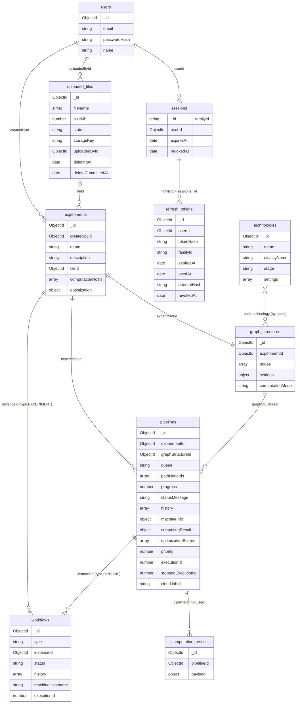

# Data model

The backend stores its data in MongoDB (database from `MONGODB_URI`) through Typegoose models. Identifiers are `_id` everywhere; they are ObjectIds, except `sessions._id`, which is a UUID string (the `familyId` of the session's refresh tokens). The diagram shows the ten collections and how they refer to each other; fields are the key ones, not a complete list.

## Collections

| Collection            | Model               | Purpose                                                                                                                                                                                                                                                                 |
| --------------------- | ------------------- | ----------------------------------------------------------------------------------------------------------------------------------------------------------------------------------------------------------------------------------------------------------------------- |
| `users`               | `User`              | Accounts: unique lower-case `email`, `passwordHash`, optional `name`.                                                                                                                                                                                                   |
| `sessions`            | `Session`           | One document per login (its `_id` is the `familyId` of the session's refresh tokens): `userId`, `expiresAt` and `revokedAt`. A revoked session stops all its refresh tokens. See [Authentication](../api/authentication.md#user-sessions).                              |
| `refresh_tokens`      | `RefreshToken`      | The refresh tokens rotated from one login, stored only as SHA-256 hashes (`tokenHash`) with `familyId`, `expiresAt`, `usedAt`, `attemptHash` and `revokedAt`.                                                                                                           |
| `experiments`         | `Experiment`        | One experiment of a user: name, description, the attached file, the machines that computed it (`computationHosts`) and the optimization state (`optimization`: `status`, `progress`, `bestPipelineId`, `bestScore`, `history`).                                         |
| `graph_structures`    | `GraphStructure`    | The graph of an experiment: the embedded `nodes` (each with `label`, `stage`, `technology`, `settings`, `type`, `parentId`), the `settings` (metric weights, `queues`, `folds`, `hyperOptimizationMinutesPerPipeline`, `predictDataPercent`) and the `computationMode`. |
| `pipelines`           | `Pipeline`          | One run: the path as `pathNodeIds`, the `queue`, progress and messages, `history`, `machineInfo`, the result (`computingResult`), `optimizationScores`, and the execution fields (`executionId`, `stoppedExecutionId`, `cloudJobId`).                                   |
| `workflows`           | `Workflow`          | The status and the status history of an experiment or a pipeline, with the current `executionId` and, for running `local` pipelines, `machineHostname`. See [Lifecycle](lifecycle.md).                                                                                  |
| `uploaded_files`      | `UploadedFile`      | Metadata of a CSV file stored in S3 (`storageKey`); deletion uses a lease (`deletingAt`) and a point of no return (`deleteCommittedAt`).                                                                                                                                |
| `technologies`        | `Technology`        | The catalog of technologies per stage with their configurable `settings`. Filled by the seeder `technologiesSeeder` on startup.                                                                                                                                         |
| `computation_results` | `ComputationResult` | Defined (`pipelineId`, `payload`) but not used by the current code: results are stored in `pipelines.computingResult`.                                                                                                                                                  |

## Relations

- `experiments.createdById` is the owner. A pipeline belongs to the owner of its experiment (see [Authentication](../api/authentication.md)).
- A graph is created together with its experiment (`GraphManager.createDefaultGraph`); there is one graph per experiment.
- Graph nodes are embedded in `graph_structures.nodes`, not a collection of their own. A pipeline stores the ids of the nodes on its path in `pathNodeIds`; a node refers to its parent through `parentId`. A technology is referenced from a node by its name (`node.technology`), not by id.
- `workflows` points to an experiment or a pipeline through `instanceId` and `type` (`EXPERIMENT` or `PIPELINE`). The reference is not enforced by the database, and a pipeline's status is read from its workflow.
- `uploaded_files` is referenced from `experiments.fileId` (optional). A file that experiments use can be deleted, which detaches it from them (`FileStore.remove`):
  - deletion is refused while any experiment that uses the file is `computing` or `optimization`;
  - otherwise the owner of the file must confirm the detachment: `deleteUploadedFile` takes `detachExperimentIds`, and every experiment of the owner that still uses the file has to be listed, so an experiment that started using it after the user reviewed the list is not detached. `uploadedFileUsage` returns the list;
  - after the confirmation the deletion is committed (`deleteCommittedAt`), `experiments.fileId` is cleared on every experiment that used the file (experiments of other users are only counted in the messages, never named, and are detached too), and the S3 object and the record are deleted. A failed step can be retried;
  - an exclusive lease (`deletingAt`, 15 minutes) allows one deletion of a file at a time and stops an experiment from attaching the file or starting to compute on it meanwhile.

## Indexes and migrations

- Unique: `users.email`, `technologies.name`, `graph_structures.experimentId` and `refresh_tokens.tokenHash`.
- TTL indexes remove `sessions` and `refresh_tokens` documents once their `expiresAt` has passed; `refresh_tokens.familyId` is indexed.
- Plain indexes: `experiments.createdById`, `pipelines.experimentId` and `pipelines.graphStructureId`.
- `workflows` has a unique partial index on `machineHostname` for `PIPELINE` workflows in `running`: at most one running `local` run per machine. The backend awaits `WorkflowModel.init()` on startup and fails if the index cannot be built. There is no index on `workflows.instanceId`, although every status read filters by it.
- `runMigrations()` runs on every start (`backend/src/migrations`), so every migration must change nothing on a second run. Current migrations: `pipeline-legacy-statuses-to-idle` (old statuses become `idle`) and `pipeline-history-missing-status-to-running` (fills in the missing `status` of pipeline history entries).
