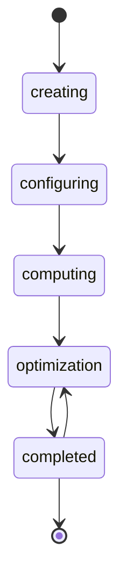
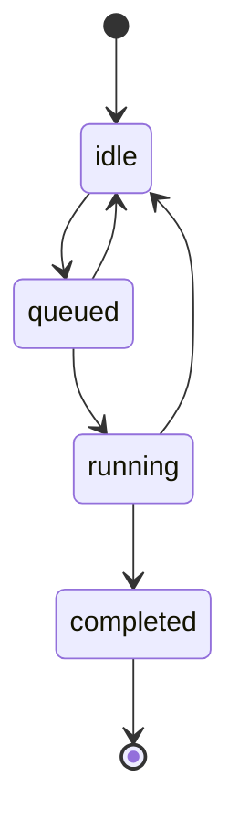

# Experiment and pipeline lifecycle

The status of an experiment and of a pipeline (run) is stored in a separate `workflows` document, not in the experiment or pipeline itself (see [Data model](data-model.md) and [ADR 0002](decisions/0002-mongo-backed-workflows.md)). A status can change only along the transitions listed below; any other change is rejected with `TRANSITION_NOT_FOUND`.

The terms are defined in [Experiments and computations](../domain/experiments.md#terms).

## Experiment

Source of truth: `ExperimentManager.transitions` in `backend/src/modules/experiments/services/ExperimentManager.ts`.

| Transition                   | Triggered by                                                                                         | Side effect                                                                                                                                                                              |
| ---------------------------- | ---------------------------------------------------------------------------------------------------- | ---------------------------------------------------------------------------------------------------------------------------------------------------------------------------------------- |
| `creating → configuring`     | The first change of graph nodes, graph settings or computation mode (`updateExperiment`, `generateExperimentGraph`) | None.                                                                                                                                                                      |
| `configuring → computing`    | The desktop app calls `changeExperimentStatus` when the user starts computations                     | Checks that the experiment has an available CSV file (otherwise the status is put back to `configuring` and the error is returned), then generates the pipelines (see below).            |
| `computing → optimization`   | `optimizeExperimentRuns` (`ComputationManager.optimize`)                                             | None. Allowed only when every pipeline is `completed`.                                                                                                                                  |
| `optimization → completed`   | The optimization job finished                                                                        | None.                                                                                                                                                                                    |
| `completed → optimization`   | `optimizeExperimentRuns` on a completed experiment                                                   | None. Optimization can be run again.                                                                                                                                                    |

Notes:

- Graph and experiment changes are rejected in `computing`, `optimization` and `completed`; changes in `creating` or `configuring` set the status to `configuring`.
- Generating the pipelines creates one pipeline per combination of path and selected queue (`PipelineManager.generatePipelinesFromGraphStructure`), each with a workflow in `idle`. Pipelines are queued automatically when `shouldAutoQueueGeneratedPipeline` allows it: a `cloud` pipeline when the backend runs any worker, and a `local` pipeline only when `cloud` is not selected as well.
- Optimization has its own status in `experiment.optimization.status`: `optimizing`, `failed` or `completed`. It is stored on the experiment and is separate from the workflow status above. A second optimization is refused while this status is `optimizing`.

## Pipeline

Source of truth: `PipelineManager.transitions` in `backend/src/core/pipeline/services/PipelineManager.ts`. The enum `PipelineStatus` has exactly four values: `idle`, `queued`, `running` and `completed`. There is no `failed` or `stopped` status (see [Known limitations](known-limitations.md)).

| Transition            | Triggered by                                                                                 | Side effect on the pipeline                                                                                                       |
| --------------------- | -------------------------------------------------------------------------------------------- | --------------------------------------------------------------------------------------------------------------------------------- |
| `idle → queued`       | `enqueueExperimentRuns`, `resumeExperimentRuns`, or automatic queueing after generation      | Sets `progress` to 0, the message to "В черзі" and `priority` to 0; removes `machineInfo` and `cloudJobId`.                        |
| `queued → idle`       | `pauseExperimentRuns`                                                                        | Removes `machineInfo`, `cloudJobId`, `progress` and the status message.                                                           |
| `queued → running`    | A worker claims the run (`claimExperimentRun`)                                               | Sets `progress` to 0 and the message to "Обчислення". The claim also writes the new `executionId` (and `machineHostname` for `local` runs) to the workflow in the same update. |
| `running → completed` | The worker reports the result (`completePipeline`), or the cloud worker reads it from S3     | The result is saved first; then `progress` is set to 100 and the message to "Завершено".                                          |
| `running → idle`      | `stopExperimentRun`, `pauseExperimentRuns`, or a worker reports a failure (`failExperimentRun`) | Removes `machineInfo`, `progress` and the status message. `cloudJobId` is kept so that Stop or Pause can still cancel the job.      |

Rules that apply to every transition:

- The status update is a conditional write: it matches the status that was read, so two callers cannot both win the same transition. The loser gets `TRANSITION_CONFLICT`.
- Each transition adds an entry to the workflow history (previous status, next status, message, time) and an entry to the pipeline history.
- Each side effect is scoped to the `executionId` that the transition belongs to. A report from an earlier execution of the same pipeline matches nothing and cannot change a newer execution.
- `changePipelineStatus` (the API mutation) can use only the transitions that do not start from `running`. A running execution is ended by the user (`stopExperimentRun`) or by the worker (`failExperimentRun`, `completePipeline`).
