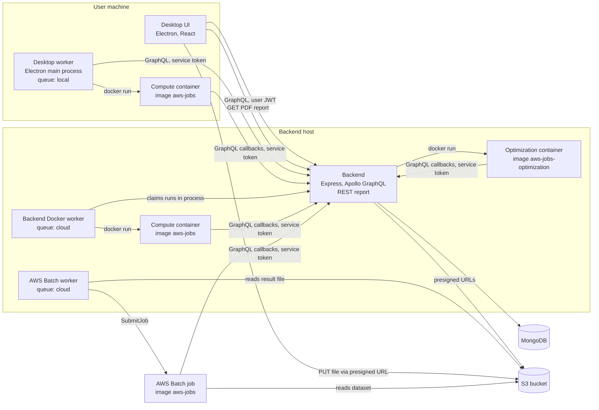

# System overview

The system has a desktop application, a backend, MongoDB, an S3 bucket and containers that run the machine-learning jobs. The containers are started by workers: one worker lives in the desktop app, two live in the backend.

## Components

| Component                           | Technology                                  | Responsibility                                                                                                                                                                                                                         | Code                                   |
| ----------------------------------- | ------------------------------------------- | -------------------------------------------------------------------------------------------------------------------------------------------------------------------------------------------------------------------------------------- | -------------------------------------- |
| Desktop UI                          | Electron, React, Apollo Client              | Registration and login, file upload, the graph constructor, starting and stopping runs, results, the PDF download. It polls the backend every 5 seconds for statuses.                                                                  | `desktop/src`                          |
| Desktop worker                      | Electron main process, Docker CLI           | Serves the `local` queue: claims runs, starts a compute container for each, and stops it when the run is paused or stopped. At most one running `local` run per machine.                                                               | `desktop/src/workers/localComputation` |
| Backend                             | Node.js, TypeScript, Express, Apollo Server | The GraphQL API at `/graphql`, the REST report, authentication, the experiment and pipeline workflows, claiming of runs, and the optimization runner. It also starts the workers below.                                                | `backend/src`                          |
| Backend Docker worker               | Node.js in the backend process, Docker CLI  | Serves the `cloud` queue without AWS: claims a run and runs a compute container on the backend host. Enabled by `BACKEND_LOCAL_WORKER_ENABLED` (default on).                                                                           | `LocalBackendComputationWorker`        |
| AWS Batch worker                    | Node.js in the backend process, AWS SDK     | Serves the `cloud` queue through AWS Batch: claims a run, submits a Batch job with the run payload, and reads results from S3. Enabled by `BACKEND_CLOUD_WORKER_ENABLED` and needs the Batch queue, job definition and results bucket. | `CloudComputationWorker`               |
| Optimization runner                 | Node.js in the backend process, Docker CLI  | After all pipelines are `completed`, runs the optimization container on the backend host.                                                                                                                                              | `OptimizationRunner`                   |
| Compute and optimization containers | Python 3.11                                 | `compute_handler.py` computes one pipeline; `optimization_handler.py` ranks the completed pipelines of an experiment. They read data and report results through the GraphQL API.                                                       | `aws-jobs/src/aws_jobs`                |
| MongoDB                             | MongoDB 7                                   | All persistent data. See [Data model](data-model.md).                                                                                                                                                                                  | `docker-compose.yml`                   |
| S3 bucket                           | AWS S3                                      | CSV files. The desktop uploads directly with a presigned URL; the backend only signs URLs.                                                                                                                                             | `StorageClient`                        |

## Queues and who serves them

A pipeline belongs to one queue, chosen when the pipelines are generated: `local` or `cloud`. Workers only claim runs of their own queue.

| Queue   | Served by                                                                      | Where the run executes                   |
| ------- | ------------------------------------------------------------------------------ | ---------------------------------------- |
| `local` | The desktop worker                                                             | A Docker container on the user's machine |
| `cloud` | The backend Docker worker, the AWS Batch worker, or both when both are enabled | The backend host, or an AWS Batch job    |

If both `cloud` workers are enabled they compete for the same queue and whichever claims a run first executes it. The default setup in [Setup](../../SETUP.md) turns the AWS Batch worker off.

## Who talks to whom

- The user's client sends a **user JWT**; workers and their containers send the **service token** (`BACKEND_SERVICE_TOKEN`). See [Authentication](../api/authentication.md).
- Containers do not touch MongoDB. They read the experiment and pipeline through GraphQL and report progress and results through GraphQL callbacks (see [ADR 0003](decisions/0003-graphql-callbacks-from-workers.md)).
- Containers that run on the same host as the backend reach it at `http://host.docker.internal:4000/graphql`. The Docker socket is mounted into the backend container so that the backend can start sibling containers (see `docker-compose.yml`).
- The backend is the only component that writes workflow statuses.

For the runtime flow of one run, see [Run execution](run-execution.md).
