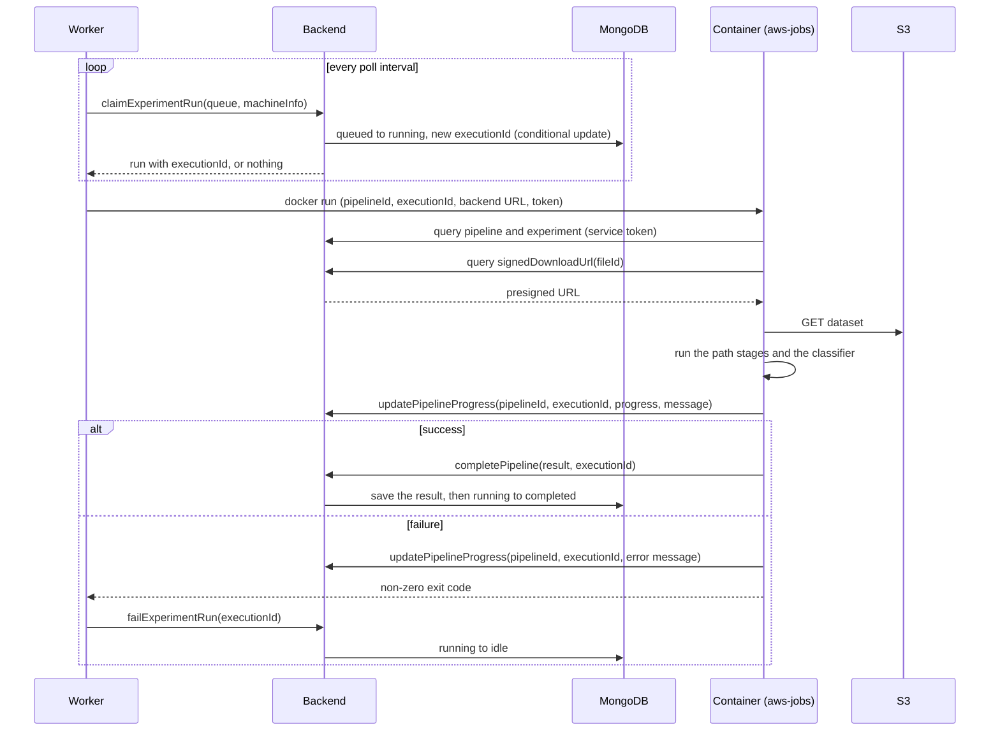

# Run execution

This page follows an experiment from its creation to its optimization result. Statuses and transitions are in [Lifecycle](lifecycle.md); the components are in [Overview](overview.md).

## From experiment to queued runs

1. **Create.** `createExperiment` stores the experiment and creates an empty graph (`GraphManager.createDefaultGraph`) with the workflow `creating`.
2. **Upload the dataset.** The desktop asks `signedUploadUrl` (the S3 key is issued under the signed-in user), uploads the CSV straight to S3 with `PUT`, then calls `createUploadedFile`. The experiment refers to the file through `fileId`.
3. **Configure.** The user builds the graph (`generateExperimentGraph` or `updateExperiment`) and the graph settings (metric weights, queues, folds). The first change moves the experiment to `configuring`. The graph rules are in [Experiments and computations](../domain/experiments.md).
4. **Start computing.** `changeExperimentStatus` moves the experiment to `computing`. The backend checks that the CSV is available and generates one pipeline per combination of path (`buildGraphPaths`) and selected queue, each with the workflow `idle`. Pipelines that are queued automatically move to `queued` right away.
5. **Enqueue.** `enqueueExperimentRuns` (all runs or one) checks the graph settings, the allowed queue and the classification stage on every path, then moves `idle` pipelines to `queued`. Only the owner of the experiment can call it.

## Claim, compute, report

### Claiming

`claimExperimentRun` is a worker operation (service token). `ComputationManager.claimNextRun` takes the queued runs of the worker's queue, ordered by `priority` and `updatedAt`, and for each candidate:

1. raises the pipeline's `executionId` and clears an old result;
2. changes the workflow `queued → running` with a conditional update that also stores the `executionId` (and `machineHostname` for `local` runs);
3. on a lost race or a duplicate hostname, moves to the next candidate or returns nothing.

Details and the guarantees are in [Claiming runs](../domain/experiments.md#claiming-runs). Every later report carries the `executionId`, and the backend ignores reports of an execution that is no longer current. A run that was stopped and queued again therefore cannot be changed by the container of its earlier execution.

### Who executes

| Worker                | How it runs the job                                                                                                                                                                                                                                  | How it learns about the end                                                                                                                                                                                                                                                                               |
| --------------------- | ---------------------------------------------------------------------------------------------------------------------------------------------------------------------------------------------------------------------------------------------------- | --------------------------------------------------------------------------------------------------------------------------------------------------------------------------------------------------------------------------------------------------------------------------------------------------------- |
| Desktop worker        | Fetches the experiment through GraphQL, builds the payload (path nodes with technologies and settings) and starts `docker run` of the `aws-jobs` image; the payload goes to the container on stdin and the service token in `COMPUTE_BACKEND_TOKEN`. | The container calls `completePipeline`; on an error the worker calls `failExperimentRun`. A watcher polls the run status and aborts the container when the run is no longer the claimed execution (stop or pause).                                                                                        |
| Backend Docker worker | Starts `docker run` of the `aws-jobs` image with `COMPUTE_PAYLOAD_JSON`, `COMPUTE_BACKEND_URL` and `COMPUTE_BACKEND_TOKEN`.                                                                                                                          | The same callbacks. When the process exits with an error or without a final status, the worker calls `failRun`. A watcher aborts the container when the run is stopped.                                                                                                                                   |
| AWS Batch worker      | Builds the payload (path, dataset location, result key) and calls `SubmitJob` with `COMPUTE_PAYLOAD_JSON`. The Batch job id is saved in `cloudJobId`, unless Stop or Pause marked the execution first; then the worker cancels the job itself.       | The job calls `completePipeline`. In addition, every poll the worker reads a result file from S3 for each running `cloud` run and completes or fails the run from it (no component writes that file today; see [Known limitations](known-limitations.md)). `TerminateJob` cancels a job on Stop or Pause. |

### Stop and pause

`stopExperimentRun` stops a `running` pipeline; `pauseExperimentRuns` stops all `queued` and `running` pipelines of an experiment and `resumeExperimentRuns` queues the `idle` ones again. For a running `cloud` run the Batch job is terminated first. The pipeline returns to `idle` and its execution is no longer current, so the container's late reports are ignored.

## Optimization

1. The user calls `optimizeExperimentRuns` on an experiment in `computing` or `completed`. The backend checks the graph metrics and that **every** pipeline of the experiment is `completed`.
2. The experiment moves to `optimization`, and `OptimizationRunner` starts the `aws-jobs-optimization` container on the backend host. It sends the payload (experiment id, backend URL, service token, minutes per pipeline) on stdin.
3. The container reads the experiment and all its pipelines through GraphQL, normalizes the metric values of the pipelines, ranks them with the metric weights, and reports through `updateExperimentProgress`, `updatePipelineOptimization` (a score for each pipeline) and `updateExperimentOptimizationResult` (the best pipeline and its score).
4. When the container exits successfully the experiment moves to `completed`. The call to `optimizeExperimentRuns` returns only then, with the result. The time limit of the container is the minutes per pipeline multiplied by the number of paths.

The PDF report (`GET /experiments/:experimentId/report`) is built from the experiment, its graph, pipelines and optimization data at the time of the request.
