# User guide

This guide takes you through the whole workflow in the desktop application: from signing in and
uploading a dataset to reading the results and downloading the PDF report. Button and field names
are given as they appear in the English interface (switch the language with **EN** / **UA** in the
application). The terms (experiment, graph, stage, path, pipeline, queue, fold) are defined in
[Experiments and computations](../domain/experiments.md#terms).

Before you start, install and start the application as described in the
[setup guide](../../SETUP.md) and prepare a dataset that follows the
[dataset format](dataset-format.md). To try the application first, use
[`example-dataset.csv`](example-dataset.csv). If something goes wrong, see
[Troubleshooting](troubleshooting.md).

## 1. Create an account and sign in

1. On the **Sign in** page choose **Create one**.
2. Fill in the full name, email and password (at least 6 characters) and choose
   **Create account**. You are signed in right away.
3. Next time open the **Sign in** page, enter the email and password and choose **Sign in**.
   **Log out** is at the bottom of the left menu.

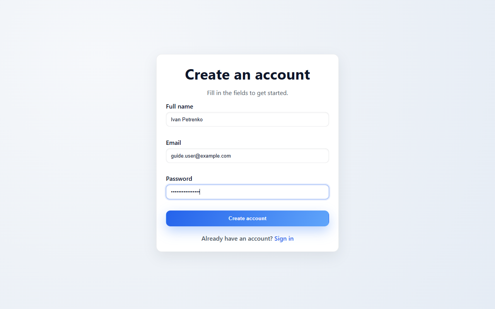

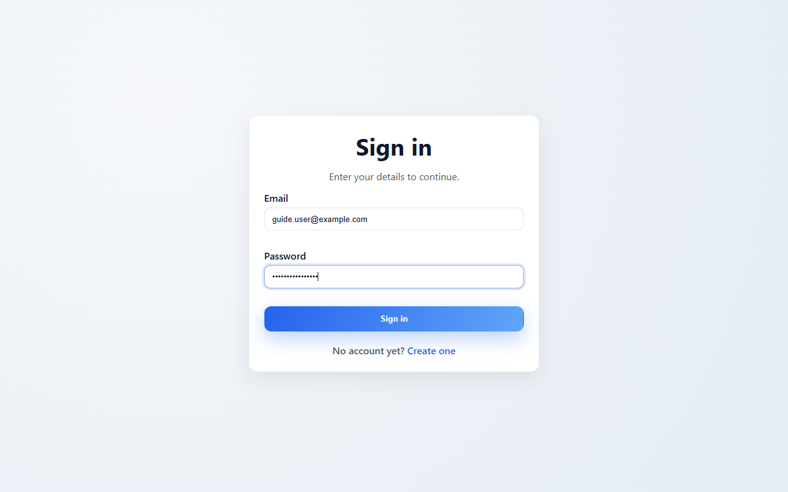

The left menu has three sections: **Overview** (system status and the latest files and
experiments), **Experiments** and **Files**.

## 2. Upload a dataset

1. Open **Files** and choose **Upload file**.
2. Select a `.csv` file. Other file types are rejected with "Only CSV files are supported."
3. The file appears in the **Uploaded files** list with its size and status.

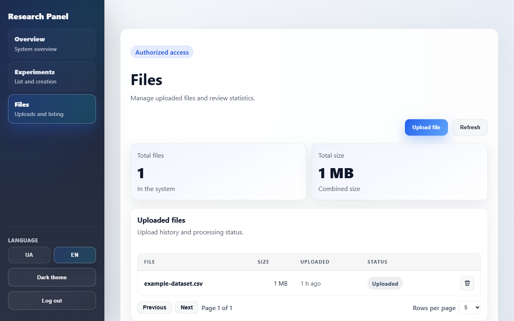

The app only checks the file extension. The content is checked when a computation starts, so verify the
file against the [dataset format](dataset-format.md) first.

To remove a file choose the trash icon in its row. The file is detached from the experiments that use
it, and it cannot be deleted while one of them is computing or optimizing.

## 3. Create an experiment

1. Open **Experiments** and choose **Create experiment**.
2. Enter the **Experiment name** (required) and an optional **Description** (up to 400
   characters).
3. Pick an uploaded file in the **File** list or choose **Upload CSV** to upload a new dataset.
   You can also attach a file later with **Edit**.
4. Choose **Create experiment**, then click the new experiment in the list to open it.

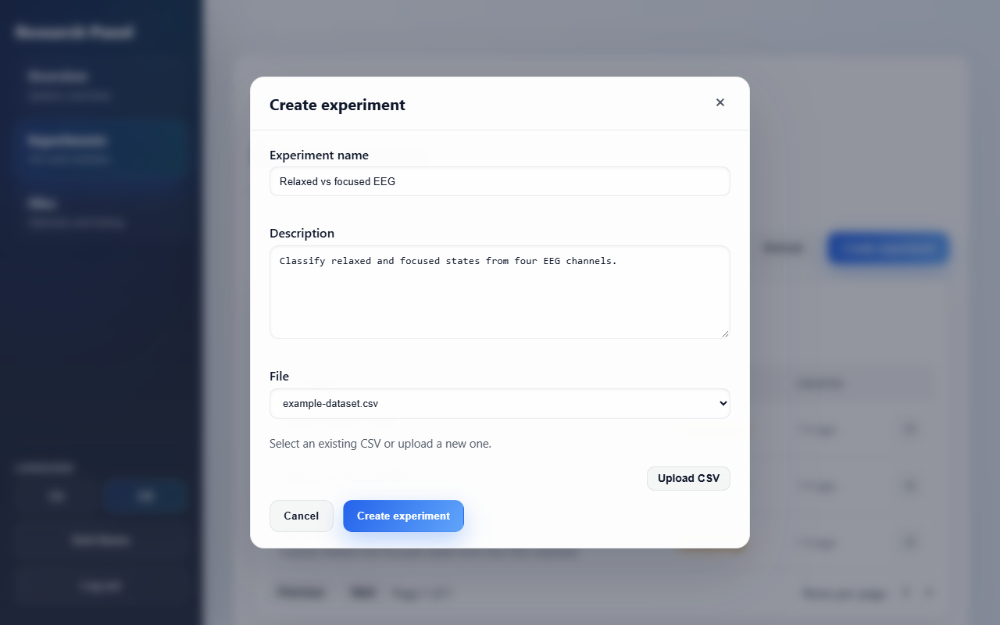

The experiment page shows its details, the attached **EEG file** and the status. Use **Edit** to
change the name, the description or the file (pick an uploaded one or upload a new CSV).

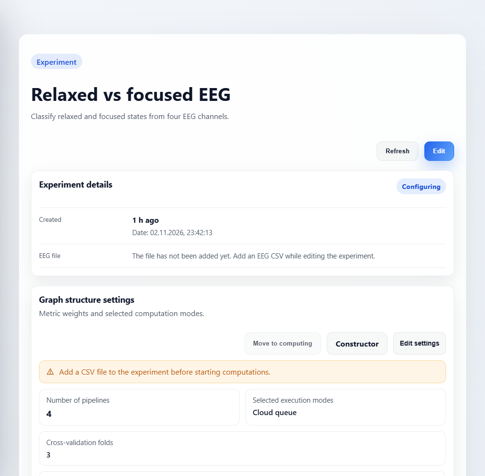

## 4. Build the graph

An experiment describes the processing as a graph. Each node is a technology that belongs to one
stage, and the stages always go in this order:

1. Preprocessing
2. Data enhancement
3. Feature extraction
4. Dimensionality reduction
5. Classification

Every chain of nodes from the start to a leaf is a **path**, and every path must end with a
**Classification** node.

Open the graph with **Constructor** on the experiment page.

**Build it by hand**

- The **+** button on the **Start** node adds a first node, the **+** button on any other node adds a
  child node. Pick the stage, the technology and, if the technology has them, its settings. A child
  node can only belong to a later stage than its parent.
- The pencil edits a node and the trash icon deletes it. Deleting a node deletes all its child
  nodes too and cannot be undone. A node with children also has an arrow that collapses and expands
  its branch.

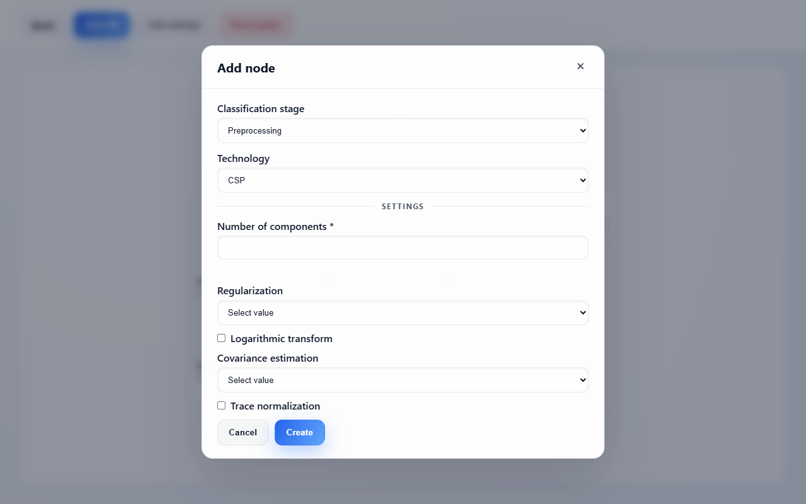

**Build it automatically**

- Choose **Auto-fill**, select the technologies for each stage and choose **Generate**. Select at
  least one technology for the Classification stage; the other stages are optional. The graph is
  built from every combination of the selected technologies in stage order. For example, ICA, PCA
  and SVM give four paths: ICA → PCA → SVM, ICA → SVM, PCA → SVM and SVM.

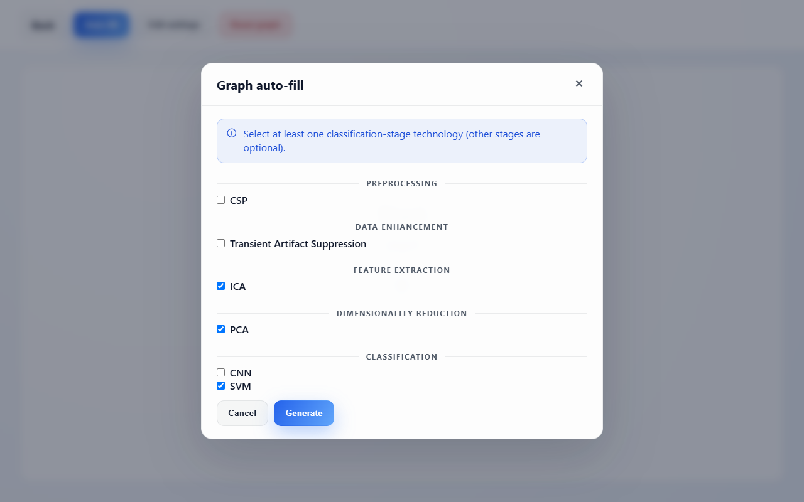

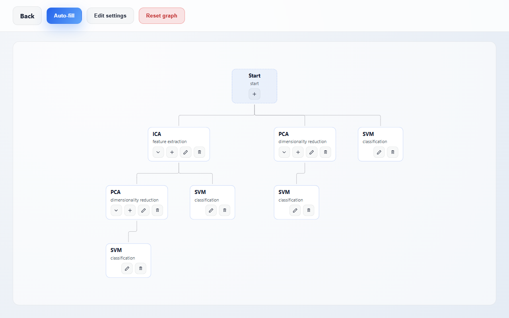

**Start over**

- **Reset graph** deletes all nodes. It asks for confirmation.

## 5. Set the graph settings

Choose **Edit settings** (on the experiment page or in the constructor). The form starts with
equal metric weights (25% each), 5 folds, 30 minutes of optimization per pipeline, 20% of data for
prediction and the **Local** mode. Save the form even if you keep the defaults, because the
experiment cannot move on without saved settings.

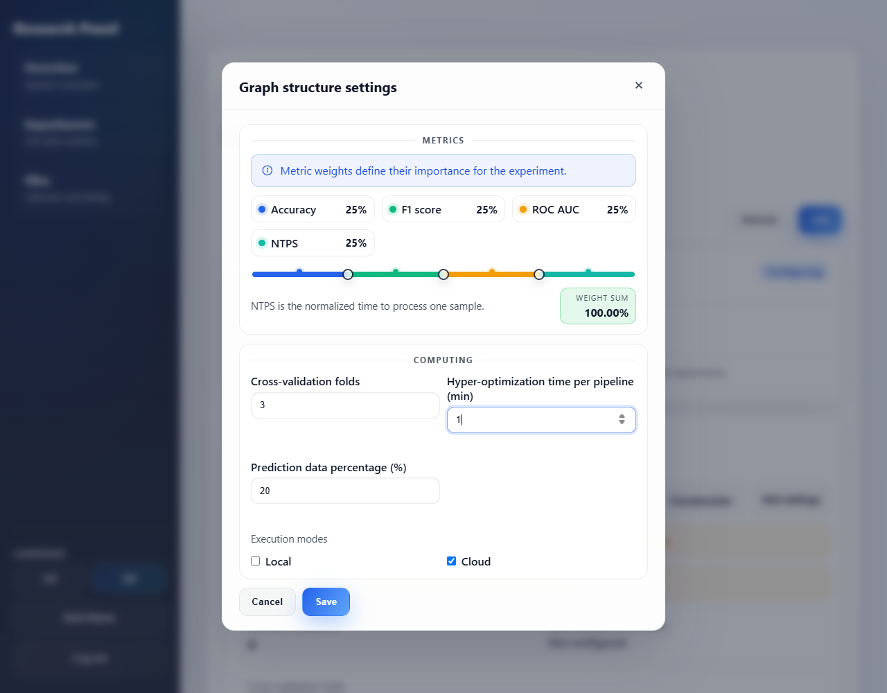

| Setting                                    | Meaning                                                                                                                                                                                                            |
| ------------------------------------------ | ------------------------------------------------------------------------------------------------------------------------------------------------------------------------------------------------------------------ |
| Metric weights (%)                         | How important accuracy, F1, ROC AUC and NTPS are. The four weights must add up to 100%.                                                                                                                            |
| Cross-validation folds                     | How many times the data is randomly split into a training and a prediction part (repeated stratified random splits). An integer from 1 to 20. Rows can appear in several splits; the parts are not disjoint folds. |
| Hyper-optimization time per pipeline (min) | How long the optimization may spend on one pipeline. An integer greater than 0.                                                                                                                                    |
| Prediction data percentage (%)             | The share of data held back for prediction in every split, from 1 to 99. It must leave at least one row per class in both parts; see [Classification requirements](dataset-format.md#classification-requirements). |
| Execution modes                            | **Local** (on your computer), **Cloud**, or both. At least one is required.                                                                                                                                        |

NTPS is the normalized time to process one sample of data.

## 6. Start the computations

Choose **Move to computing**. The button is enabled when the graph settings are saved and valid,
and a dataset is attached. After this step the experiment, the graph and the settings can no longer
be edited.

The **Classification pipelines** card has a **Local queue** and a **Cloud queue** tab (only the
modes you selected are active) and lists one pipeline per path. The graph preview below the table
colors each pipeline by its status:

| Color      | Status    |
| ---------- | --------- |
| Light gray | Idle      |
| Blue       | Queued    |
| Yellow     | Running   |
| Green      | Completed |

- **Local queue:** pipelines start as **Idle**. The play button in a row puts the pipeline into the
  queue, and the desktop application executes it on your computer with Docker, so keep the
  application open until it finishes. The square button stops a running pipeline and returns it to
  idle. **Move all to waiting** puts every local pipeline that is idle or running into the queue.
- **Cloud queue:** the pipelines are queued automatically when you choose **Move to computing**
  and are executed by the backend (Docker worker or AWS Batch), one after another. This needs the
  cloud worker to be configured.
- The **i** button in the **Results** column opens the details of the latest run: the metrics for
  every cross-validation fold, the confusion matrices, the dataset information, the device that
  executed the run, and the execution history.

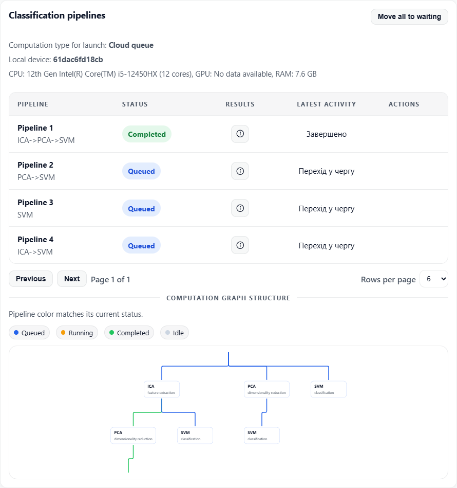

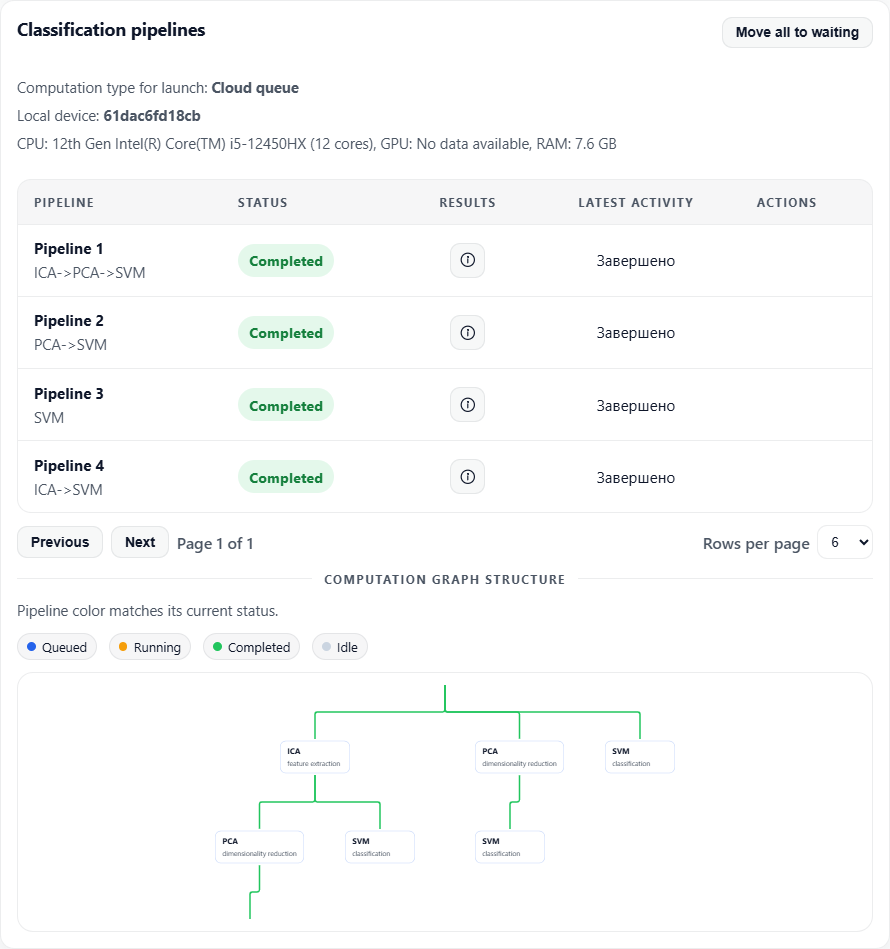

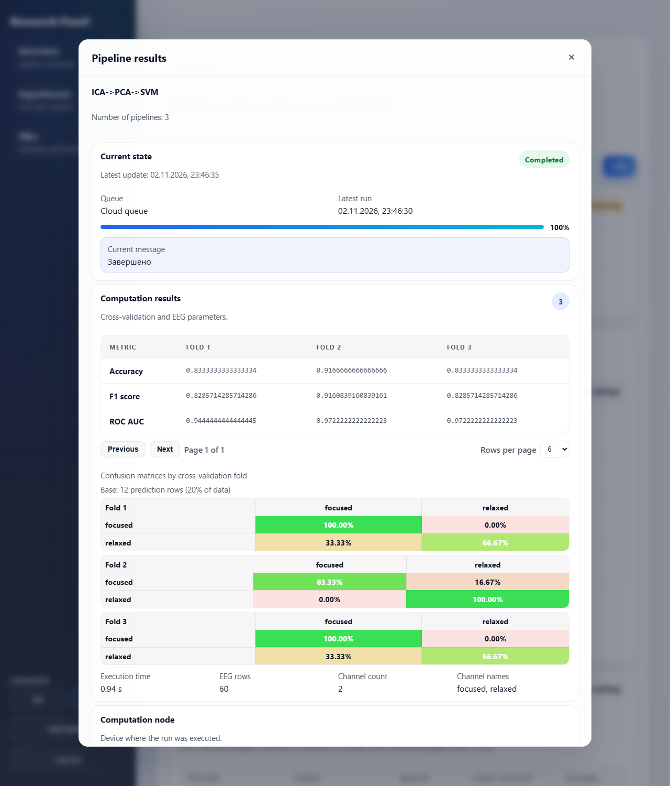

## 7. Run the optimization

When every pipeline in every selected mode is **Completed**, the **Optimization** card becomes
available.

1. Choose **Start optimization**. The progress and the latest message are shown while it runs.
2. When it finishes you see the **Best pipeline** with its composition, the **Leaderboard** with
   the score of each pipeline, a chart that compares the pipelines and the optimization
   **History** log.

The score of a pipeline is the integral value: the weighted sum of its normalized metrics using the
metric weights. A higher accuracy, F1 or ROC AUC and a shorter processing time (NTPS) lower the
score. **A lower score is better.** Choose **Restart optimization** to run it again.

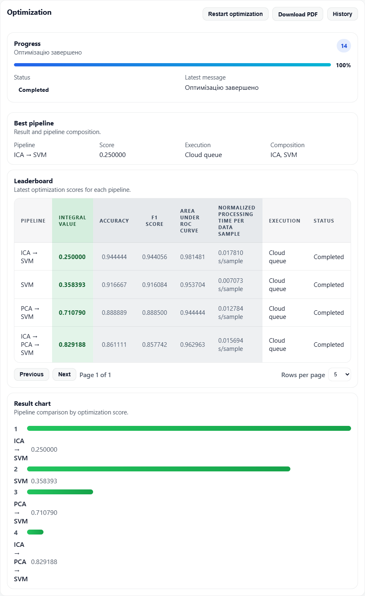

## 8. Read the results and download the report

When the optimization has finished, the experiment status is **Completed** and **Download PDF**
appears at the top of the experiment page (the **Optimization** card has the same button). The
report contains the experiment details, the graph
settings, every pipeline with its stage settings and per-fold metrics, and the best pipeline.

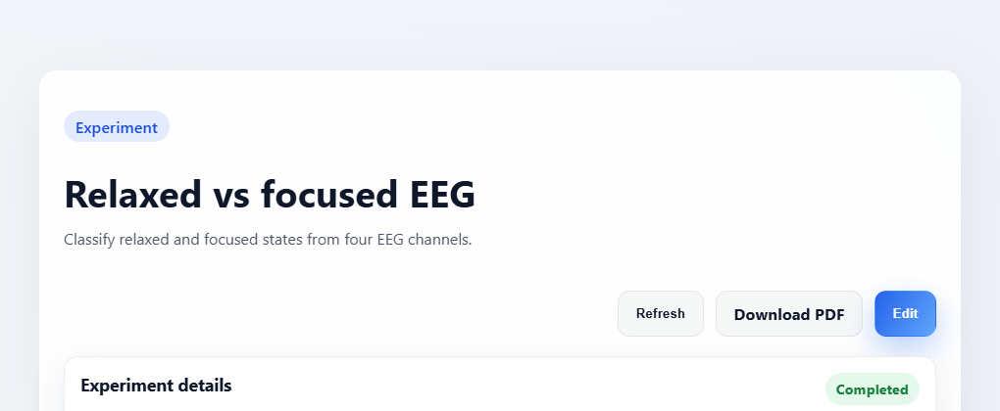
