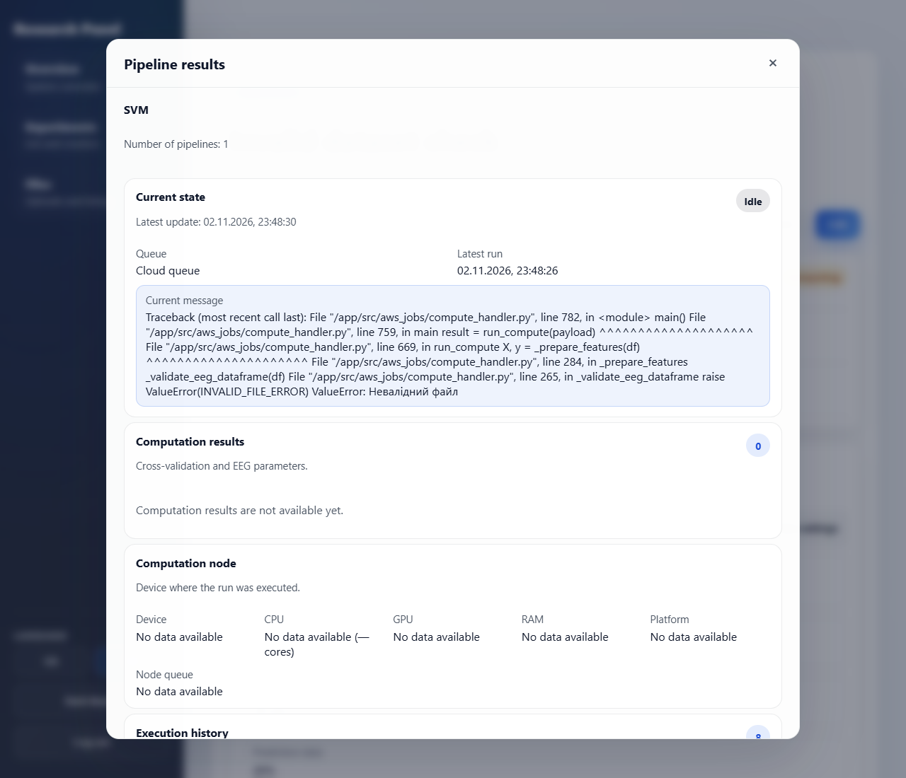

# Troubleshooting

This page covers problems you can meet while working with experiments. Problems with installing and
starting the application (CORS and S3 errors, Docker, port 4000, `Not authenticated`, WSL) are
described in the [setup guide](../../SETUP.md#troubleshooting).

## The run fails with "Невалідний файл" or `EEG_FILE_EMPTY`

**Symptom:** the pipeline returns to **Idle**, and the **Current message** in its results (the **i**
button in the pipeline row) ends with `ValueError: Невалідний файл` or `EEG_FILE_EMPTY`.

**Cause:** the dataset does not meet the [dataset format](dataset-format.md). The upload only checks
the file extension and the file type, so the content is validated when the run starts.

**Fix:** correct the file (semicolon separator, numeric features with a dot decimal separator, no
empty cells, no class label such as `NA` or `null` (see the
[list of rejected labels](dataset-format.md#requirements)), at least 3 columns and one data row), upload it on the **Files** page and attach it to
the experiment. While the experiment is still being configured you can change the file with
**Edit**. After computations have started the file cannot be replaced; create a new experiment
instead.

## The run fails because of the classes or the train/test split

**Symptom:** the pipeline returns to **Idle**, and the **Current message** in its results (the **i**
button in the pipeline row) shows one of these errors from the classification library (the same text is in the **Latest activity** column):

| Error                                                                                          | Cause                                                                                                         | Fix                                                                                          |
| ---------------------------------------------------------------------------------------------- | ------------------------------------------------------------------------------------------------------------- | -------------------------------------------------------------------------------------------- |
| `The number of classes has to be greater than one; got 1 class`                                | The first column has only one distinct label.                                                                 | Add rows of at least one more class.                                                         |
| `The least populated classes in y have only 1 member, which is too few` (it names the classes) | A class has a single row.                                                                                     | Add rows to that class or remove it from the file.                                           |
| `The test_size = N should be greater or equal to the number of classes = M`                    | The prediction part is smaller than the number of classes.                                                    | Increase **Prediction data percentage** or add rows.                                         |
| `The train_size = N should be greater or equal to the number of classes = M`                   | The training part is smaller than the number of classes.                                                      | Decrease **Prediction data percentage** or add rows.                                         |
| `With n_samples=N, test_size=… and train_size=None, the resulting train set will be empty`     | The file has too few rows for the chosen percentage.                                                          | Add rows (a one-row file always fails) or decrease the percentage.                           |
| `Out of range float values are not JSON compliant`                                             | The prediction part of a split has only one class (a very small class was left out), so ROC AUC is undefined. | Add rows to the smallest class (see the rule in the format page) or increase the percentage. |

**Cause and fix in short:** the rows are split by **Prediction data percentage**, and both parts must
be at least as large as the number of classes. The split is random and only approximate, so a very
small class can be missing from the prediction part, which fails the run with the last error in the
table. Give every class enough rows. See [Classification requirements](dataset-format.md#classification-requirements)
for the practical rule.
The settings cannot be changed after the computations have started, so create a new experiment
with the corrected settings or file.

## "Add a CSV file to the experiment before starting computations."

**Cause:** the experiment has no file. **Move to computing** stays disabled until a file is attached.

**Fix:** open **Edit**, pick an existing CSV or upload a new one, and save.

## "Move to computing" is disabled

The button needs all three conditions:

- the experiment status is `configuring` (the graph has been edited);
- the graph settings are saved and valid (metric weights adding up to 100%, at least one execution mode, the optimization time per pipeline and the prediction data percentage);
- a CSV file is attached.

## The graph settings cannot be saved

The settings form shows the reason:

- "The weight sum must equal 100%." Set the four metric weights so they add up to 100.
- "Select at least one computation mode." Choose **Local**, **Cloud** or both.
- "Cross-validation folds must be an integer greater than 0." Use a value from 1 to 20. A larger value shows the same message followed by the maximum (`... greater than 0. 20.`).
- "Prediction data percentage must be an integer from 1 to 99."

## "All pipelines must contain a classification stage."

**Cause:** at least one path of the graph does not end with a node from the **Classification** stage.

**Fix:** open the **Constructor** and add a classification node to every path, or use **Auto-fill**
and select at least one classification technology.

## The run stays in "Queued"

A local run waits for the desktop worker. Keep the desktop app open and make sure Docker is
running. See "Local runs stay queued" in the [setup guide](../../SETUP.md#troubleshooting).

If the pipelines instead return to **Idle** and their message says `Not authenticated`, the Local
queue itself is the problem: the desktop worker does not pass the backend token to its container.
Create a new experiment with only **Cloud** selected. A cloud run waits for a worker on the
backend: the Docker worker or AWS Batch.

## Cloud runs do not start, and the backend prints "Хмарний воркер вимкнено"

The message means "Cloud worker disabled: AWS Batch or the results bucket is not configured". It
concerns only the AWS Batch worker. The **Cloud** queue does not require AWS Batch: the backend
Docker worker also executes it, with a local Docker image.

**Fix, without AWS Batch** (works for an experiment that is already computing): in
`backend/.env` set `BACKEND_CLOUD_WORKER_ENABLED=false`, `BACKEND_LOCAL_WORKER_ENABLED=true` and
`BACKEND_SERVICE_TOKEN` to a long random string, build the `aws-jobs` image and restart the
backend, as described in the [setup guide](../../SETUP.md#3-configure-the-backend-and-s3-uploads).
The worker then takes the queued Cloud pipelines of the existing experiment, and the optimization
can start after they finish. Do not recreate the experiment with **Local** only: the Local queue
currently fails with `Not authenticated`.

**Fix, with AWS Batch:** configure AWS Batch and the results bucket as described in
[AWS Jobs (AWS Batch)](../operations/aws-batch.md) and restart the backend.

The execution mode cannot be changed after the experiment has moved to computing, and the
optimization waits for unfinished pipelines of every selected mode, so choose the mode before
**Move to computing**.

## The PDF button is missing at the top of the page

The **Download PDF** button at the top of the experiment page appears only when the experiment
status is `completed`. Finish the computations and the optimization first. The **Optimization** card
has its own **Download PDF** button.

## The PDF download fails with "Failed to generate experiment report"

**Cause:** the backend renders the report with Chromium. The Docker image of the backend includes it;
a backend started manually (`npm run start:backend`) does not, and the backend log shows that
Puppeteer could not find a browser.

**Fix:** start the backend with Docker Compose, or install Chrome or Chromium and set
`PUPPETEER_EXECUTABLE_PATH` to its executable before starting the backend.

## Computations take hours on a large file

The SVM classifier gets slower much faster than the number of rows grows, and every pipeline runs
one after another. In a test, the first pipeline of a file with 180,000 rows (three classes, 16
features) was still running after 25 minutes, while a 6,000-row sample of the same file completed
all four pipelines and the optimization in a few minutes.

**Fix:** try the workflow on a sample of the data first. A stratified sample with the same share of
every class keeps the results representative.
